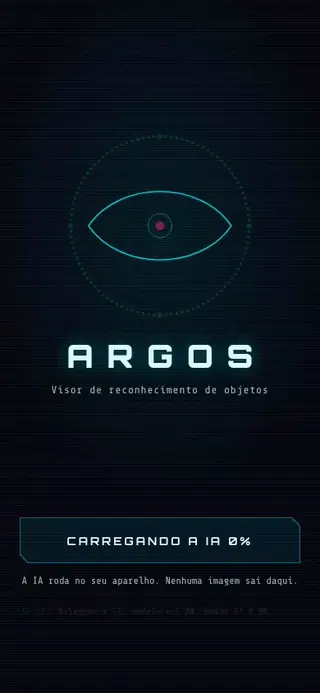
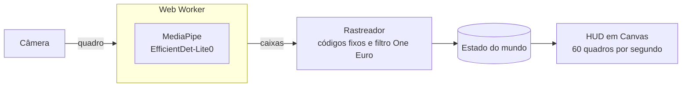

<p align="center">
  
</p>

<h1 align="center">ARGOS</h1>

<p align="center">
  Aponte a câmera e veja os objetos identificados em tempo real, num HUD de filme.<br>
  A IA roda no seu aparelho: nenhuma imagem sai dele.
</p>

<p align="center">
  <a href="https://francisco12-cpu.github.io/argos/"><strong>Abrir a demo</strong></a>
</p>

<p align="center">
  
  
  
</p>

---

## O que ele faz

- Reconhece 80 tipos de objeto do dia a dia (pessoa, celular, garrafa, cadeira, notebook, carro, cachorro...), com os nomes em português.
- Marca cada objeto com cantoneiras e uma etiqueta: código, nome e confiança, como `OBJ-0007` `CADEIRA` `92%`.
- Mantém o mesmo código enquanto o objeto está em cena e tira o tremor das caixas.
- Desenha o HUD a 60 quadros por segundo, mesmo com a IA fazendo de 7 a 10 análises por segundo.
- Tem três temas: Cyberpunk, Tático e Armadura.
- Abre no navegador do celular ou do computador, sem instalar nada.

## Como funciona



- **A IA roda num Web Worker.** O desenho nunca espera o modelo, então o HUD não engasga.
- **Um objeto só aparece depois de 3 análises seguidas** e continua na tela por até 10 análises sem ser visto, apagando aos poucos. Isso elimina o pisca-pisca de falsos positivos.
- **Entre uma análise e outra, o HUD prevê a posição** pela velocidade medida de cada objeto, o que também compensa o tempo que a IA leva para responder.
- **Nomes parecidos contam como o mesmo objeto** (copo e tigela, carro e caminhão). Se no lugar de uma pessoa aparece uma bicicleta, ela ganha código novo.

## Privacidade

A câmera é processada inteira no aparelho. Não existe servidor, conta, cookie de rastreamento nem envio de imagens: o site só baixa o motor da IA e o modelo, uma vez, e depois o navegador guarda os dois em cache.

## Rodar no seu computador

```sh
git clone https://github.com/Francisco12-cpu/argos.git
cd argos
npm start
```

Abra <http://127.0.0.1:8080>. Precisa do Node 20 ou mais novo; não há dependências para instalar.

A câmera só funciona em `https` ou em `localhost`. Para testar no celular, use o link da demo ou publique a sua cópia (abaixo).

## Publicar a sua cópia

1. Faça um fork deste repositório.
2. No fork, abra **Settings → Pages** e, em **Build and deployment**, escolha **Source: GitHub Actions**.
3. Na aba **Actions**, ative os workflows e rode **Testes e publicação**.

O site sai em `https://SEU-USUARIO.github.io/argos/`, e cada push na `main` roda os testes e publica de novo.

## Testes

```sh
npm test
```

São 50 testes automáticos (rastreador, filtro One Euro, geometria, rótulos, máquina de estados, downloads e resumo para leitores de tela), rodados também no GitHub Actions a cada push.

## Desempenho

Medido no Chromium, num servidor de 2 núcleos; o número real do seu celular aparece na barra de cima do HUD.

| Medida | Valor |
| --- | --- |
| Tempo da IA por análise | 105 a 150 ms (CPU, modelo int8) |
| Análises por segundo | 7 a 10 |
| Quadros do HUD | cerca de 60 por segundo |
| Download no primeiro acesso | 18,2 MB sem compressão (motor 13,0 MB, modelo 4,5 MB) |

## Estrutura

```text
index.html                página única
src/
  main.js                 liga os módulos e conduz os estados
  core/                   configuração, eventos, máquina de estados
  vision/                 câmera, download, detector (worker), rastreador, geometria
  hud/                    canvas: cantoneiras, etiquetas, mira, temas, efeitos
  ui/                     abertura, telemetria, tela de erro
  data/                   nomes em português e grupos de nomes parecidos
  styles/main.css
vendor/mediapipe/         MediaPipe Tasks Vision 1.1.0 (versão fixa)
models/                   EfficientDet-Lite0 int8 e lista de rótulos
assets/                   fontes e ícones
tests/                    testes com node --test
scripts/serve.mjs         servidor local sem dependências
```

## Roadmap

- [x] Fase 0: fundação (repositório, testes, publicação automática)
- [x] Fase 1: visão (câmera, IA no worker, nomes em português)
- [x] Fase 2: HUD (abertura, mira, cantoneiras, etiquetas, temas, efeitos)
- [ ] Fase 3: inteligência (travamento de alvo, fichas, distância, registro); o rastreador já está pronto
- [ ] Fase 4: sentidos (sons, voz do Javis, foto e clipe)
- [ ] Fase 5: polimento (offline, modo adaptativo, acessibilidade)
- [ ] Fase 6: lançamento

## Créditos

- [MediaPipe Tasks Vision](https://ai.google.dev/edge/mediapipe/solutions/vision/object_detector) (Google), Apache 2.0.
- EfficientDet-Lite0 treinado no [COCO](https://cocodataset.org), via [TensorFlow Lite Support](https://github.com/tensorflow/tflite-support), Apache 2.0.
- Fontes [Orbitron](https://github.com/theleagueof/orbitron) e Share Tech Mono, SIL Open Font License 1.1.
- Fotos da animação, do acervo do [scikit-image](https://scikit-image.org/docs/stable/api/skimage.data.html): astronauta Eileen Collins (NASA, domínio público), xícara de café (Rachel Michetti, CC0) e a gata Chelsea (Stefan van der Walt, CC0).

## Licença

[MIT](LICENSE). Os componentes de terceiros mantêm as próprias licenças, listadas no fim do arquivo `LICENSE`.
